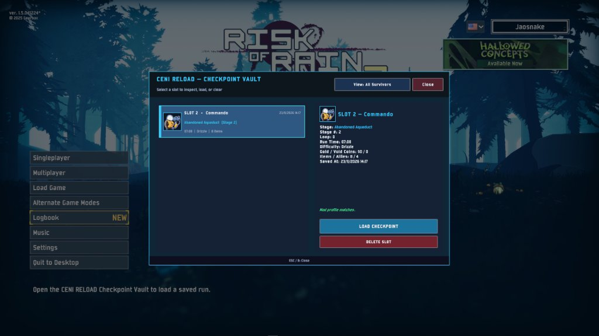

# 🧤 C.E.N.I RELOAD (`CENI_RELOAD`) — Checkpoint Vault

> ✨ **100% Written From Scratch — Original Standalone Project**  
> **C.E.N.I RELOAD** (**C**hrono-**E**nhanced **N**exus of **I**teration) is a completely original stage checkpoint vault for **Risk of Rain 2**, designed and built **100% from scratch** by **Jaosnake** under the **MIT License**.  
> Zero third-party mod code • Standalone HarmonyX (`Jaosnake.CeniReload`) • Single dependency (`BepInExPack`) • Custom `.cenireload.json` format • Redesigned two-column Card Vault UI.

> 🆕 **1.0.2** · 🛟 Backup recovery · 🔎 Pre-load checks · 📋 Restoration report · 👥 Flexible co-op · 🎲 More continuity
>
> **Cinco novidades para proteger seus checkpoints e retomar a partida com o grupo disponível.**

[🇺🇸 English](#-english) • [🇧🇷 Português (Brasil)](#-português-brasil) • [⚽ What does C.E.N.I mean?](#-what-does-ceni-mean)

---

## 🇺🇸 English

### ✨ New in 1.0.2 — Your checkpoint, your party

| New feature | What changes for you |
| :--- | :--- |
| 🛟 Backup recovery | Preview the previous save and recover it from the Vault. |
| 🔎 Checks before loading | See missing content and incompatible data before starting. |
| 📋 Restoration report | Know what was restored, skipped or could not be recovered. |
| 👥 Flexible co-op | Start with 3/4, 2/4 or solo; saved friends can join later. |
| 🎲 More continuity | Resume more random streams, vital resources and local skill state. |

> 🧤 **Play with the group available now.** Absent saved players keep their build reserved for their first later join; a new player never takes someone else’s build.

#### 🛠️ How the new features work

> 💾 **Older saves still open**, but positions and state that were never recorded cannot be recreated. Keep a copy before moving between versions.

- 🛟 **Previous backup:** select **VIEW PREVIOUS BACKUP** and confirm recovery. An unreadable primary slot offers its readable backup in the Vault; recovery preserves the current file separately. Unlock a readable locked slot before replacing it. Local updates are atomic; the cloud backend keeps a backup but has no atomicity guarantee.
- 🔎 **Checks and report:** unavailable stages/modes, unsupported formats and invalid data block loading. Missing optional items, equipment or allies are listed before loading and skipped with a report. **LAST RESTORATION REPORT** also shows partial restoration and errors. Scroll details with the mouse wheel, Page Up/Down or controller shoulder buttons.
- 👥 **Flexible co-op:** loading a co-op checkpoint prepares a listening lobby and enables late joining for that resumed run. Invite friends, inspect live presence, and press **START PREPARED CHECKPOINT** or use the host's native launch. You may start with 3/4, 2/4 or alone. Absent saved players retain their build for their first later join, even after a stage change; late joins use the current stage's spawn. New players never inherit another player's build. Reconnecting does not replay an already claimed checkpoint: the game keeps the live master state. Cancel preparation to start a normal new run.
- 🎲 **More continuity:** new checkpoints capture the run's available Xoroshiro generators as well as health, shield, barrier and skill charges/recharge progress. Skill state is applied only with effective authority; remote skills remain native in this version and the report states this limitation. This does not serialize every character controller, projectile, buff or private mod state. Older save formats remain readable, but unrecorded data cannot be reconstructed.

### 🎯 Overview

**C.E.N.I RELOAD** (`Jaosnake-CENI_RELOAD`) automatically records a stage-entry checkpoint at the start of every playable stage **from Stage 2 onward** (skipping Stage 1 so you can freely test survivors, mods, or artifacts) and adds a sleek **Checkpoint Vault** directly in both the **Main Menu** (`Load Game`) and the **Character Select lobby** so you can browse, inspect, load, or clear your saved runs anytime.

### 📸 Preview



### ⚽ What does C.E.N.I mean?

**C.E.N.I** stands for:

- **C** — **C**hrono
- **E** — **E**nhanced
- **N** — **N**exus of
- **I** — **I**teration

And it's also a clever mnemonic tribute to legendary Brazilian goalkeeper **Rogério Ceni**, iconic captain of **São Paulo FC** — famous for always **"saving"** his team with miraculous stops when it mattered most! 🧤🇧🇷  
Just like Rogério Ceni saved São Paulo on the pitch, **C.E.N.I RELOAD** saves your runs on Petrichor V! *(That's why the icon features the Brazilian flag cape and the golden trophy!)* 🏆

### 🚀 Key Features

| Feature | Description |
| :--- | :--- |
| 🛠️ **100% Original Architecture** | Built from the ground up in C# (`netstandard2.1`) under `Jaosnake.CeniReload` using HarmonyX only — single dependency (`bbepis-BepInExPack-5.4.2121`). |
| 💾 **Automatic Stage Checkpoints** | Automatically captures a full snapshot at the start of every gameplay stage **from Stage 2 onward** (Stage 1 is intentionally skipped so testing builds/mods won't clutter your slots). |
| 🗂️ **5 Rotating Slots per Survivor + 5 Co-op Slots + Slot Lock** | Stores up to **5 independent `.cenireload.json` slots** per survivor **plus 5 dedicated Multiplayer Co-op slots**, rotating the oldest unlocked slot when full. Lock any save (`Right-Click` on card with KB+M, `X` on Xbox, `Square` on PlayStation) with a glowing golden padlock badge to prevent overwrite or deletion; if all 5 slots are locked, the Vault warns you so you can unlock or delete a slot manually before continuing. |
| 👥 **Multiplayer Co-op (Host-Only)** | Only the **Host** needs `CENI_RELOAD` installed. Matches each player by **SteamID / EOS identity**: present friends restore their exact survivor, loadout, items, currency, and drones; absent players are safely skipped without breaking the run; newly joined players start fresh cleanly. The Inspector shows live lobby presence for every saved player. |
| ☁️ **Local or Steam / Epic Cloud Storage** | Saves locally in `BepInEx/config` by default, or opt in to **Steam / Epic Cloud Storage** (`UseCloudStorage = true`, configurable `CloudStorageSubDirectory` to isolate mod profiles). |
| 🎨 **Color-Coded Vault List** | The slot list & cards automatically adapt their background color by run type: **Blue** for standard Singleplayer runs, **Red** for Multiplayer runs, and **Green** for **Simulacrum**, **Artifact of Evolution**, or **Artifact of Devotion** runs. |
| 🃏 **Redesigned Two-Column Vault UI** | Open **CENI RELOAD VAULT** directly from the **Main Menu** or the **Character Select lobby** to browse visual slot cards with **survivor portraits** (*Current Survivor* / *All Survivors* filter), inspect detailed stats on the right, load checkpoints, or delete slots with inline confirmation. |
| 🛡️ **Run State & Extra Modes** | Saves run seed, stage, **loop counters & event flags**, stopwatch, difficulty, artifacts/rules (`RuleBook`), team experience, survivor loadout, gold, void coins, permanent items and **DLC3 temporary items** (stored by **item name** for mod-order safety), equipment slots/sets, owned drones/allies, plus **Simulacrum** waves/enemy inventory, **Artifact of Evolution** monster items, and **Artifact of Devotion** minion inventory. |
| 🔍 **Mod-List & Missing Survivor Protection** | Checks your active BepInEx plugin list against checkpoint metadata, flags uninstalled modded survivors with a **Missing Mod** badge/warning, and blocks launch when a present player needs a survivor that is missing. |
| 🎮 **Mouse, Keyboard & Controller** | Full standard UI navigation with **auto-scrolling slot cards**, quick lobby shortcut (`Y` on Xbox / `Triangle` on PlayStation) with controller-aware glyphs, and instant close via `ESC` or `B` / `Circle`. |
| 🌐 **Built-in EN & pt-BR Localization** | Follows the game language automatically (`CENIRELOAD_*` keys), with optional external JSON overrides in `BepInEx/plugins/CENI_RELOAD/Language/<lang>/ceni_reload.json`. |

### 📦 Installation

**Via Thunderstore Mod Manager / r2modman (Recommended):**
1. Install `bbepis-BepInExPack`.
2. Install `Jaosnake-CENI_RELOAD`.
3. Launch Risk of Rain 2 and open **CENI RELOAD VAULT** in the Character Select lobby!

**Manual Installation:**
1. Copy the ZIP’s `plugins/CENI_RELOAD/` folder into your game’s `BepInEx/plugins/` folder, so the DLL is at `BepInEx/plugins/CENI_RELOAD/CENI_RELOAD.dll`.
2. Launch Risk of Rain 2.

### ⚙️ Configuration & Storage

**Checkpoint compatibility (1.0.1):** New checkpoints record player/ally positions and the generator state used to create the stage. Older checkpoints remain readable, but their original positions were never recorded and cannot be recovered; the game chooses the player spawn and allies use safe placement. Local file replacement retains the previous checkpoint as `.bak`. Cloud storage uses its separate existing backend.

- **Config file**: `BepInEx/config/com.Jaosnake.CENI_RELOAD.cfg`
  - `AutoSaveOnStageStart` *(default: `true`)* — Automatically saves a checkpoint at the start of every playable stage from Stage 2 onward.
  - `ShowChatMessages` *(default: `true`)* — Prints a chat notification when a checkpoint is saved or restored.
  - `UseCloudStorage` *(default: `false`)* — Stores the 5-slot Vault in Steam / Epic Games Cloud Storage (`RoR2Application.cloudStorage`) instead of local disk.
  - `CloudStorageSubDirectory` *(default: `CENI_RELOAD`)* — Subdirectory inside Cloud Storage to keep separate vaults per mod profile.
- **Checkpoint Vault directory**:
  ```text
  BepInEx/config/Jaosnake.CENI_RELOAD/Vault/<profile>/<survivor>/slot_<1..5>.cenireload.json
  ```

### 📜 Source Code & License

- 💻 **Official Repository**: [https://github.com/Jaosnake/CENI_Reload](https://github.com/Jaosnake/CENI_Reload)
- ⚖️ **License**: **MIT License** — Copyright (c) 2026 **Jaosnake**. See [LICENSE](LICENSE).

---

## 🇧🇷 Português (Brasil)

> ✨ **Projeto 100% Feito do Zero — Código-Fonte Próprio e Independente**  
> O **C.E.N.I RELOAD** (**C**hrono-**E**nhanced **N**exus of **I**teration) é um cofre de checkpoints de fase para **Risk of Rain 2** totalmente original, projetado e escrito **100% do zero** por **Jaosnake** sob a **Licença MIT**.  
> Zero código de terceiros • Arquitetura própria em HarmonyX (`Jaosnake.CeniReload`) • Dependência única (`BepInExPack`) • Formato próprio `.cenireload.json` • Interface própria em cards de duas colunas.

### ✨ Novidades da 1.0.2 — Seu checkpoint, seu grupo

| Novidade | O que muda para você |
| :--- | :--- |
| 🛟 Recuperação de backup | Veja o save anterior e recupere pelo próprio cofre. |
| 🔎 Verificação antes de carregar | Confira conteúdo ausente e dados incompatíveis antes de iniciar. |
| 📋 Relatório de restauração | Saiba o que foi recuperado, ignorado ou não pôde ser restaurado. |
| 👥 Co-op flexível | Comece com 3/4, 2/4 ou solo; amigos do save podem entrar depois. |
| 🎲 Mais continuidade | Retome mais geradores aleatórios, recursos vitais e habilidades locais. |

> 🧤 **Jogue com quem estiver disponível agora.** Ausentes do save mantêm a build reservada para a primeira entrada posterior; um jogador novo nunca toma a build de outra pessoa.

#### 🛠️ Como as novidades funcionam

> 💾 **Saves antigos continuam abrindo**, mas posições e estados que nunca foram registrados não podem ser recriados. Guarde uma cópia antes de alternar versões.

- 🛟 **Backup anterior:** selecione **VER BACKUP ANTERIOR** e confirme a recuperação. Um slot principal ilegível oferece o backup legível no cofre; a recuperação preserva o arquivo atual separadamente. Destranque um slot legível antes de substituí-lo. Atualizações locais são atômicas; a nuvem mantém backup, mas sem garantia de atomicidade.
- 🔎 **Verificação e relatório:** fases/modos indisponíveis, formatos incompatíveis e dados inválidos impedem a carga. Itens, equipamentos ou aliados opcionais ausentes são listados antes da carga e ignorados com registro. **ÚLTIMO RELATÓRIO DE RESTAURAÇÃO** mostra também recuperação parcial e erros. Role os detalhes com a roda do mouse, Page Up/Down ou os botões de ombro do controle.
- 👥 **Co-op flexível:** carregar um checkpoint cooperativo prepara um lobby que aceita conexões e habilita entradas tardias nessa partida retomada. Convide amigos, confira a presença atualizada e use **INICIAR CHECKPOINT PREPARADO** ou o início nativo do host. Pode iniciar com 3/4, 2/4 ou sozinho. Jogadores ausentes do save mantêm a build reservada para sua primeira entrada posterior, inclusive após mudança de fase; entradas tardias usam o ponto da fase atual. Jogadores novos não herdam a build de outra pessoa. Reconectar não reaplica um checkpoint já utilizado: o jogo mantém o estado atual do master. Cancele a preparação para começar uma partida nova normal.
- 🎲 **Mais continuidade:** novos checkpoints capturam os geradores Xoroshiro disponíveis na partida, além de vida, escudo, barreira, cargas e progresso de recarga das habilidades. O estado das habilidades só é aplicado com autoridade efetiva; habilidades remotas permanecem nativas nesta versão, com essa limitação no relatório. Isso não serializa todos os controladores de personagens, projéteis, buffs ou estados privados de mods. Formatos antigos continuam legíveis, sem reconstruir dados que nunca registraram.

### 🎯 Visão Geral

O **C.E.N.I RELOAD** (`Jaosnake-CENI_RELOAD`) grava automaticamente um checkpoint de entrada na fase no início de cada fase jogável **a partir da Fase 2** (pulando a Fase 1 para você testar personagens, mods ou artefatos sem poluir os slots) e adiciona o **Cofre CENI RELOAD** tanto no **Menu Principal** (`Carregar Jogo`) quanto na tela de **Seleção de Personagem** para você visualizar, inspecionar, carregar ou limpar seus checkpoints quando quiser.

### 📸 Prévia


### ⚽ O que significa C.E.N.I?

**C.E.N.I** é a sigla de:

- **C** — **C**hrono
- **E** — **E**nhanced
- **N** — **N**exus of
- **I** — **I**teration

E também é um mnemônico em homenagem ao lendário goleiro brasileiro **Rogério Ceni**, eterno ídolo do **São Paulo FC** — famoso por sempre **"salvar"** o time nos momentos mais difíceis! 🧤🇧🇷  
Assim como o Rogério Ceni salvava o São Paulo em campo, o **C.E.N.I RELOAD** salva as suas runs em Petrichor V! *(É por isso que o ícone traz a capa da bandeira do Brasil e a taça dourada!)* 🏆

### 🚀 Recursos Principais

| Recurso | Descrição |
| :--- | :--- |
| 🛠️ **Arquitetura 100% Autoral** | Escrito do zero em C# (`netstandard2.1`) em `Jaosnake.CeniReload` usando apenas HarmonyX — dependência única (`bbepis-BepInExPack-5.4.2121`). |
| 💾 **Checkpoints Automáticos por Fase** | Registra automaticamente um snapshot completo no início de cada fase jogável **a partir da Fase 2** (a Fase 1 nunca é salva, evitando poluir seus slots ao testar mods, personagens ou artefatos). |
| 🗂️ **5 Slots por Sobrevivente + 5 Slots Co-op + Cadeado (Lock)** | Armazena até **5 slots independentes em `.cenireload.json`** por sobrevivente **e mais 5 slots dedicados para Multiplayer Co-op**, substituindo o slot desbloqueado mais antigo quando cheio. Tranque qualquer save (**Botão Direito** no card com mouse, **`X`** no Xbox ou **`Quadrado`** no PlayStation) com ícone dourado de cadeado brilhante para impedir sobrescrita ou exclusão; se os 5 slots estiverem trancados, o Cofre e o chat avisam que não há espaço até você destrancar ou apagar um slot manualmente. |
| 👥 **Multiplayer Co-op (Apenas o Host)** | Somente o **Host** precisa ter o `CENI_RELOAD` instalado. Cada jogador é casado pelo **SteamID / EOS**: amigos presentes recebem de volta seus personagens, loadouts, itens, moedas e drones; jogadores ausentes são pulados sem quebrar a partida; jogadores novos entram limpos sem herdar builds de terceiros. O painel inspetor mostra quem está no lobby ou ausente. |
| ☁️ **Armazenamento Local ou Nuvem (Steam / Epic Cloud)** | Salva localmente em `BepInEx/config` por padrão, ou ative a **Nuvem da Steam / Epic** (`UseCloudStorage = true`, com `CloudStorageSubDirectory` configurável para isolar perfis de mods). |
| 🎨 **Cores por Modo na Lista de Slots** | O fundo da lista e dos cards muda automaticamente conforme o tipo da partida: **Azul** para Singleplayer padrão, **Vermelho** para **Multiplayer** e **Verde** para **Simulacrum**, **Artifact of Evolution** ou **Artifact of Devotion**. |
| 🃏 **Interface de Cofre em Duas Colunas** | Abra o **COFRE CENI RELOAD** direto no **Menu Principal** ou no **lobby de Seleção de Personagem** para navegar pelos cards visuais com **retratos dos sobreviventes** (filtro *Sobrevivente Atual* / *Todos*), ver os detalhes completos no painel direito, carregar checkpoints ou excluir slots com confirmação integrada. |
| 🛡️ **Estado da Partida e Modos Extras** | Salva seed, fase, **contadores de loop e flags de evento**, cronômetro, dificuldade, artefatos/regras (`RuleBook`), experiência do time, loadout, ouro, moedas do vazio, itens permanentes e **itens temporários da DLC3** (salvos pelo **nome do item** para segurança entre mods), equipamentos, drones/aliados, além de ondas e inventário inimigo do **Simulacrum**, itens de monstros do **Artifact of Evolution** e inventário do **Artifact of Devotion**. |
| 🔍 **Verificação de Mods e Sobrevivente Ausente** | Compara os plugins ativos do BepInEx com o checkpoint, identifica sobreviventes de mods removidos com aviso **Mod Ausente** e impede iniciar quando um jogador presente precisa de um sobrevivente ausente. |
| 🎮 **Mouse, Teclado e Controle** | Navegação padrão completa com **auto-scroll na lista de cards**, atalho rápido no lobby (`Y` no Xbox / `Triângulo` no PlayStation) com ícone dinâmico do controle e fechamento rápido com `ESC` ou `B` / `Círculo`. |
| 🌐 **Localização Nativa EN e pt-BR** | Segue automaticamente o idioma do jogo (chaves `CENIRELOAD_*`), com suporte opcional a JSON externo em `BepInEx/plugins/CENI_RELOAD/Language/<idioma>/ceni_reload.json`. |

### 📦 Instalação

**Via Thunderstore Mod Manager / r2modman (Recomendado):**
1. Instale `bbepis-BepInExPack`.
2. Instale `Jaosnake-CENI_RELOAD`.
3. Inicie o Risk of Rain 2 e clique em **COFRE CENI RELOAD** na tela de Seleção de Personagem!

**Instalação Manual:**
1. Copie a pasta `plugins/CENI_RELOAD/` do ZIP para `BepInEx/plugins/` do jogo, deixando a DLL em `BepInEx/plugins/CENI_RELOAD/CENI_RELOAD.dll`.
2. Inicie o Risk of Rain 2.

### ⚙️ Configuração e Armazenamento

**Compatibilidade dos checkpoints (1.0.1):** Novos checkpoints registram as posições do jogador/aliados e o estado do gerador usado para criar a fase. Checkpoints antigos continuam legíveis, mas suas posições originais não foram registradas e não podem ser recuperadas; o jogo escolhe o ponto do jogador e os aliados usam posicionamento seguro. A substituição local conserva o checkpoint anterior em `.bak`. A nuvem usa seu backend separado já existente.

- **Arquivo de configuração**: `BepInEx/config/com.Jaosnake.CENI_RELOAD.cfg`
  - `AutoSaveOnStageStart` *(padrão: `true`)* — Salva automaticamente um checkpoint no início de cada fase jogável a partir da Fase 2.
  - `ShowChatMessages` *(padrão: `true`)* — Mostra um aviso no chat sempre que um checkpoint é salvo ou restaurado.
  - `UseCloudStorage` *(padrão: `false`)* — Armazena o Cofre de 5 slots na Nuvem da Steam / Epic (`RoR2Application.cloudStorage`) em vez do disco local.
  - `CloudStorageSubDirectory` *(padrão: `CENI_RELOAD`)* — Subpasta dentro da nuvem para separar cofres entre diferentes perfis de mods.
- **Pasta do Cofre de Checkpoints**:
  ```text
  BepInEx/config/Jaosnake.CENI_RELOAD/Vault/<perfil>/<sobrevivente>/slot_<1..5>.cenireload.json
  ```

### 📜 Código-Fonte e Licença

- 💻 **Repositório Oficial**: [https://github.com/Jaosnake/CENI_Reload](https://github.com/Jaosnake/CENI_Reload)
- ⚖️ **Licença**: **Licença MIT** — Copyright (c) 2026 **Jaosnake**. Consulte [LICENSE](LICENSE).

---

<p align="center"><strong>💡 IDEAS HAVE NO COPYRIGHT • IDEIAS NÃO TÊM COPYRIGHT 💡</strong></p>
